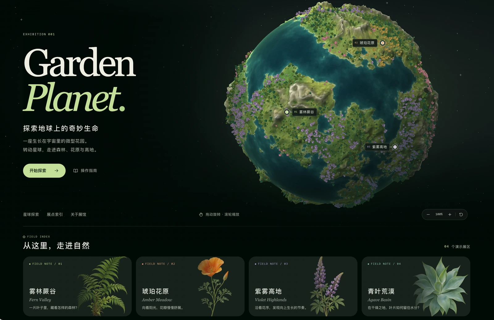

# 🌍 Wonder Nature

### Explore the extraordinary side of nature.


[](https://wonder-nature.xingh.cc)

**Wonder Nature · 奇妙自然**

一座开源、可交互的数字自然博物馆。

自然界远比我们想象的奇妙。

有些植物会在触碰后迅速闭合叶片，有些会捕捉昆虫，还有些拥有令人难以置信的生存方式。

Wonder Nature 希望把这些奇妙的生命现象，变成每个人都能亲手探索的互动体验。

在这里，你不只是阅读知识，而是通过旋转、观察、触碰和实验，亲自发现自然的奥秘。

**我们的愿景：让自然科普从静态阅读，变成充满惊喜的互动探索。**

---

*An open-source, interactive digital natural-history museum.*

*Nature is far more extraordinary than we imagine. Some plants close their leaves the instant they are touched, some trap insects, and some survive in ways that are hard to believe.*

*Wonder Nature turns these remarkable living phenomena into interactive experiences anyone can explore first-hand. Here you don't just read about nature — you rotate, observe, touch and experiment to discover its secrets yourself.*

*Our vision: turn nature education from passive reading into a delightful interactive exploration.*

---

[🌐 在线体验 Wonder Nature](https://wonder-nature.xingh.cc) · [Live site](https://wonder-nature.xingh.cc)

---

## 🌱 当前版本：v0.2.0

Wonder Nature 仍处于早期开发阶段。当前已经完成第一阶段的花园星球探索原型。

*Wonder Nature is still in early development. The first phase — the Garden Planet exploration prototype — is complete.*

### 已实现功能 · What's implemented

**交互式花园星球 · Interactive garden planet**

用户可以通过鼠标或触控旋转、缩放星球，从不同角度观察风格化的自然环境。

*Rotate and zoom the planet with mouse or touch to observe a stylized natural environment from any angle.*

**植物与生态展区 · Plant habitats**

通过星球上的探索点和底部植物卡片，发现不同的模拟自然生境，阅读相应的介绍信息。

*Explore simulated habitats through markers on the globe and the botanical cards below, each with its own field note.*

**沉浸式视觉体验 · Immersive visuals**

结合 WebGL、原创植物插画和交互设计，尝试打造兼具视觉美感与探索趣味的数字展馆。

*WebGL rendering, original plant illustrations and interaction design come together as a digital gallery that is both beautiful and fun to explore.*

目前的星球和展点仍属于早期设计原型，并不完全对应真实地理环境或物种分布。

*The current planet and exhibits are early prototypes and do not fully correspond to real geography or species distribution.*

---

## 🚧 项目开发状态 | Development Status

Wonder Nature 目前仍处于早期开发阶段（v0.2.0）。

当前版本已实现基础的花园星球探索体验。部分规划中的功能，包括互动植物展品、真实地球探索和个人收藏系统等，尚未正式上线。

**项目正在持续开发与迭代中，更多有趣的自然互动体验将在未来版本中逐步推出。**

---

**Wonder Nature is currently in early development (v0.2.0).**

The current release includes the foundational Garden Planet exploration experience. Several planned features, including interactive botanical exhibits, real-world Earth exploration, and personal collections, are not yet available.

**Development is ongoing, and more interactive nature experiences are planned for future releases.**

---

## 🔭 Roadmap · 未来规划

Wonder Nature 的目标不只是一个能旋转的地球，而是逐步发展为一座收录全球奇妙植物的互动自然博物馆。

*The goal is not merely a spinning globe, but an interactive natural-history museum of the world's most fascinating plants.*

### Phase 01 · 花园星球 Garden Planet

**当前阶段 · Current**

完善首页视觉设计、星球旋转与缩放、植物展区导航，让用户拥有完整流畅的探索体验。

*Refine the homepage visuals, globe rotation and zoom, and habitat navigation for a complete, smooth exploration experience.*

### Phase 02 · 自然超能力 Natural Superpowers

**正在探索 · In exploration**

建设可交互的植物展品，让用户亲自体验植物的特殊能力。

*Build interactive exhibits where visitors experience plants' special abilities first-hand.*

计划中的展品包括 · Planned exhibits:

- 含羞草 · Mimosa：触碰叶片，观察闭合反应。*Touch the leaves and watch them close.*
- 捕蝇草 · Venus flytrap：探索植物如何捕捉猎物。*Discover how plants catch their prey.*
- 茅膏菜 · Sundew：观察植物利用黏液捕食的机制。*Watch a plant trap prey with sticky droplets.*

每个展品将结合交互动画、科学解释和观察记录。

*Each exhibit combines interactive animation, scientific explanation and observation notes.*

### Phase 03 · 探索真实地球 Real Earth

**未来规划 · Planned**

逐步升级星球的真实地貌和地理信息。将植物与实际分布区域联系起来，让用户探索不同大陆、国家和生态环境中的奇妙物种。

*Upgrade the planet's real terrain and geography, linking plants to their actual regions so visitors can explore species across continents, countries and ecosystems.*

### Phase 04 · 个人自然博物馆 Personal Museum

**长期构想 · Vision**

加入植物发现记录、观察手记和个人收藏系统，让用户建立属于自己的数字自然收藏馆。

*Add discovery logs, field notes and a personal collection system so visitors build their own digital natural-history collection.*

---

## 💚 为什么做 Wonder Nature？ · Why

我们希望探索一种新的科普形式：

**不是把一本百科全书搬到网页上，而是让知识变成可以体验的事物。**

让好奇心成为探索的起点，让互动成为理解自然的方式。

Wonder Nature 仍在不断建设中。我们欢迎对自然科学、交互设计、WebGL、3D 可视化和创意编程感兴趣的开发者关注项目、提出建议与参与贡献。

---

*We want to explore a new kind of science communication: not moving an encyclopedia onto a webpage, but turning knowledge into something you can experience.*

*Curiosity becomes the starting point of exploration, and interaction becomes the way to understand nature.*

*Wonder Nature is still growing. Developers interested in natural science, interaction design, WebGL, 3D visualization and creative coding are welcome to follow the project, raise ideas and take part.*

---

## 🛠 技术栈 · Tech stack

| 层 Layer | 选择 Choice |
| --- | --- |
| 框架 Framework | Next.js 16 (App Router) · React 19 |
| 语言 Language | TypeScript 5.9 (strict) |
| 渲染 Rendering | 自研 WebGL 渲染器 + Canvas 2D 软件回退（无 three.js） |
| 素材 Assets | 程序化生成的地形/植被图集与原创 SVG 标本板（Python 脚本可重建） |
| 样式 Styling | 手写 CSS，系统字体栈，无网络字体 |
| 部署 Deployment | 静态导出（`next build` → `out/`），任意静态托管 |

---

## 🚀 快速开始 · Getting started

需要 **Node.js 20.9+** 与 npm。

```bash
git clone https://github.com/wusansing-cloud/Wonder-Nature-OpenSource.git
cd Wonder-Nature-OpenSource
npm ci
npm run dev        # http://localhost:3000
```

手机与电脑同一 Wi-Fi 下体验：`npm run dev -- --hostname 0.0.0.0`

构建静态站点：

```bash
npm run typecheck   # 生成 Next 类型 + tsc --noEmit
npm run build       # 静态导出到 out/
python3 -m http.server 8000 --directory out   # 预览
```

请通过 HTTP 访问 `out/`，直接双击 `out/index.html` 无法加载资源。`out/` 可部署到任意静态托管。

*Requires Node.js 20.9+ and npm. Run `npm ci && npm run dev`, then open http://localhost:3000 . To build: `npm run build` (exports to `out/`) and serve it over HTTP.*

---

## 🤝 贡献 · Contributing

本项目以 MIT 协议开放源码，欢迎你 Fork 后自由修改、学习与二次开发。欢迎在 Issues 中提出建议、反馈问题、交流想法。

官方仓库的版本由作者维护，**不合并外部代码到官方分支**——你的二改归你的二改，官方是官方，二者不混用。官方网站与官方发布版本始终由作者控制。

详见 [CONTRIBUTING.md](CONTRIBUTING.md)。

---

*The source is MIT-licensed: fork, study and remix it freely. Suggestions, bug reports and ideas are welcome in Issues.*

*The official repository is maintained by the author and does not merge outside code into the official branch — your fork is your fork, and the official project stays the official project. The official site and releases remain under the author's control. See [CONTRIBUTING.md](CONTRIBUTING.md).*

---

## 📄 开源协议 · Licence

代码与随包的原创素材采用 [MIT License](LICENSE)。

第三方素材与依赖遵循各自许可证，详见 [THIRD_PARTY_NOTICES.md](THIRD_PARTY_NOTICES.md)。

*Code and original assets are released under the [MIT License](LICENSE). Third-party assets and dependencies keep their own licences — see [THIRD_PARTY_NOTICES.md](THIRD_PARTY_NOTICES.md).*

---

**Made with curiosity. 🌿**
