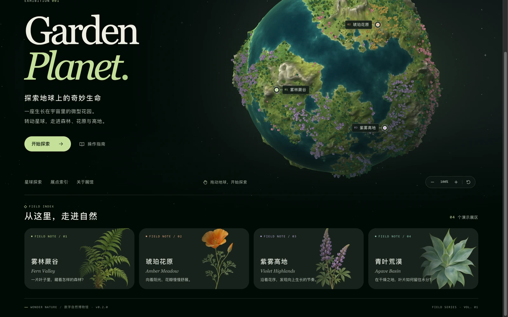

# Wonder Nature · 奇妙自然

**A miniature natural-history museum growing on a planet in space.**


[](https://wonder-nature.xingh.cc)

**Live site:** https://wonder-nature.xingh.cc

---

## What is this?

Wonder Nature is an interactive WebGL exhibition: a hand-built, procedurally generated **garden planet** you can rotate, zoom and explore. Four simulated habitats — a fern valley, an amber meadow, violet highlands and an agave basin — sit on the globe as markers. Opening one reveals a field note about the plant form it is modelled on.

The scene is built entirely from code and original assets: terrain, coastlines, relief shading, vegetation billboards and vector specimen plates ship with the project and can be regenerated with the scripts in `scripts/`.

This is **v0.2.0**, the first public source release: refined homepage UI, the stylized garden planet, and the updated plant cards and navigation. The real-Earth terrain rebuild and the in-development exhibits (such as the mimosa study) are *not* part of this release.

## Features

- **Orbital home view** — drag with the mouse or one finger to rotate; wheel or pinch to zoom between 72% and 178%.
- **Four exhibit markers** projected onto the sphere, plus an index of botanical cards that fly the camera to each habitat.
- **Field notes** — a lightweight info card per exhibit with an original vector plate.
- **Keyboard support** — focus the globe, then arrow keys rotate, `+` / `-` zoom, `Home` resets the view, `Esc` closes the card.
- **Two rendering paths** — WebGL for the normal path, and a depth-buffered Canvas software renderer as a fallback when WebGL is unavailable, sharing the same height map, camera, vegetation and picking logic.
- **Render on demand** — the scene redraws only on interaction, camera transitions or resize.
- **Static export** — `next build` produces a plain `out/` directory. No server, API key, account or external map service is required.
- **Responsive** — verified on desktop and a 390 × 844 mobile viewport, with markers exposed as focusable buttons.

[](https://wonder-nature.xingh.cc)

## Tech stack

| Layer | Choice |
| --- | --- |
| Framework | Next.js 16 (App Router), React 19, static export |
| Language | TypeScript 5.9 (strict) |
| 3D rendering | Custom WebGL renderer + Canvas 2D software fallback (no three.js in this release) |
| Assets | Procedurally generated PNG/WebP atlases and original SVG plates, rebuilt by Python scripts |
| Styling | Hand-written CSS in `src/app/globals.css`, system font stacks only (no webfonts) |

## Getting started

Requires **Node.js 20.9+** and npm.

```bash
git clone https://github.com/wusansing-cloud/Wonder-Nature-OpenSource.git
cd Wonder-Nature-OpenSource
npm ci
npm run dev
```

Open the address printed in the terminal (http://localhost:3000 by default). To try it on a phone on the same Wi-Fi network:

```bash
npm run dev -- --hostname 0.0.0.0
```

## Build

```bash
npm run typecheck        # generate Next types + tsc --noEmit
npm run build            # static export to out/
python3 -m http.server 8000 --directory out
```

Then open http://localhost:8000 . Serve `out/` over HTTP — opening `out/index.html` straight from the file system will not load its assets. The `out/` directory can be deployed to any static host.

## Project structure

| Path | Responsibility |
| --- | --- |
| `src/app/` | Page entry, metadata, responsive styles |
| `src/components/Museum.tsx` | Brand, exhibition layout, navigation and guide |
| `src/components/GlobeView.tsx` | Client scene mounting, markers, loading state, zoom controls |
| `src/components/InfoCard.tsx` | Exhibit field note card |
| `src/components/ExhibitIndex.tsx` | Exhibit index and specimen plates |
| `src/hooks/useExplorer.ts` | Selection, zoom, readiness and scene commands |
| `src/data/exhibits.ts` | Exhibit coordinates, labels, colours, notes and plate references |
| `src/globe/camera.ts` · `scene.ts` | Projection, camera, gestures, vegetation drawing, marker visibility |
| `src/globe/assets.ts` · `mesh.ts` | Texture decoding, deterministic vegetation distribution, displaced sphere mesh |
| `src/globe/terrain.ts` · `software.ts` | Native WebGL renderer and depth-buffered Canvas software renderer |
| `public/atlas/` | Terrain surface, relief and vegetation atlases |
| `public/art/` | Original vector specimen plates, star field and botanical plates |
| `scripts/` | Local dev entry point and optional offline asset generators |

### Editing exhibits

Add an exhibit in `src/data/exhibits.ts`: give it a stable `id`, a simulated latitude/longitude, copy, colour and plate paths. Markers, index cards and the mobile layout are data-driven, and the exhibit count in the index heading follows the data.

### Regenerating assets

The atlases and vector plates are reproducible with Python 3, Pillow, NumPy and SciPy:

```bash
python3 scripts/generate-terrain.py      # public/atlas/surface.webp, relief.png
python3 scripts/generate-vegetation.py   # public/atlas/vegetation.webp
python3 scripts/generate-specimens.py    # public/art/*.svg
```

These scripts are artist tools only — they are not needed to run or build the site.

## Known limitations (v0.2.0)

- The planet is **stylized and fictional**. Exhibit coordinates are simulated and do not represent real species distributions.
- The real-Earth relief rebuild and the cloud/atmosphere work are still in development and are not included.
- The software rendering fallback works but is noticeably slower than the WebGL path on low-end devices.
- Physical touch on mobile Safari and Android WebView, and hardware-accelerated paths there, still need device verification.
- No audio, no persistence, no backend: this is a single-page exhibition.

## Roadmap

| Version | Scope |
| --- | --- |
| `v0.2.1` | Bug fixes, accessibility and device-compatibility polish |
| `v0.3.0` | New stable exhibits and interactions |
| `v1.0.0` | First stable release of the core experience |

Development happens in a private working repository. Public releases are cut from accepted, tagged snapshots and synced here — individual development commits are never published automatically.

## Contributing

Issues and pull requests are welcome; please read [CONTRIBUTING.md](CONTRIBUTING.md) first.

This repository is public source, **not** a shared-write project: only the owner and explicitly invited maintainers can push to the official repository or cut releases. Forking and adapting your own copy under the MIT licence is fully allowed.

## Licence and assets

- **Code and original assets:** MIT — see [LICENSE](LICENSE).
- Third-party components and asset provenance: [THIRD_PARTY_NOTICES.md](THIRD_PARTY_NOTICES.md).
- The Wonder Nature name, logo, exhibition identity and the live site `wonder-nature.xingh.cc` remain the project owner's. The MIT licence covers the source code; it does not grant the right to present a deployment as the official Wonder Nature site.

---

## 中文简介

**Wonder Nature · 奇妙自然** 是一座可以旋转、缩放、探索的微型自然展馆。星球、地形、植被与标本插画全部由代码与原创素材生成，四处模拟生境以展点标记分布在球面上，点开即可阅读观察笔记。

当前开源版本为 **v0.2.0（UI Refined Public Release）**：包含精修后的首页、风格化花园星球、植物卡片与导航。真实地球形态重建、云层实验与含羞草等开发中功能**不包含**在此版本内。

- 在线体验：https://wonder-nature.xingh.cc
- 本地运行：`npm ci && npm run dev`（需 Node.js 20.9+）
- 构建静态站点：`npm run build`，产物位于 `out/`，用任意静态服务器托管即可
- 许可证：MIT；第三方素材与出处见 [THIRD_PARTY_NOTICES.md](THIRD_PARTY_NOTICES.md)

本仓库为公开发布的源码快照。开发仍在私有仓库进行，只有通过验收的正式版本才会同步到这里；官方仓库与官方网站的写入权限仅归作者及被授权的维护者所有。欢迎提交 Issue 与 Pull Request，也欢迎 Fork 后按 MIT 许可证自行修改。
